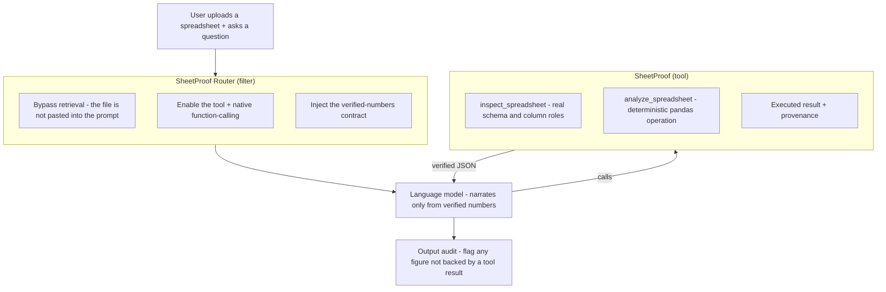

<div align="center">

# SheetProof

### Deterministic spreadsheet analysis for Open WebUI

Ask questions about an **Excel or CSV** upload and get answers whose figures are **computed by
pandas from the file** and returned with provenance, instead of being worked out by the model.

[](https://github.com/Almehmadi-Ai/sheetproof/actions/workflows/ci.yml)
[](LICENSE)


</div>

---

## Why

Language models read and explain tables well but are unreliable at arithmetic on them: asked to
sum a pasted column or rank its regions, a model is often wrong, and a wrong total looks exactly
like a right one. SheetProof moves the arithmetic out of the model:

1. With the companion filter, the uploaded spreadsheet is **kept out of retrieval**, so its rows are
   not pasted into the prompt; the model works with the file through tool calls.
2. Every statistic, group, pivot, trend and row-level value comes from a **deterministic pandas
   engine**, with **provenance** (columns used, rows processed, the operation).
3. An **output audit** checks the final answer: figures that appear in no tool result are logged,
   or optionally flagged in the answer itself.

---

## Features

- **Uploads as they are**: `.xlsx`, `.xls`, `.xlsm`, `.csv`, `.tsv`. The tool reads the file the user
  attached (after Open WebUI's access check), picks the data sheet, and finds the header row even
  below a title or banner.
- **Schema first**: every column gets a role (`measure`, `dimension`, `temporal`, `identifier`,
  `text`, `boolean`) inferred from its values, with dtype, null and distinct counts and samples. No
  column names or business vocabulary are hard-coded.
- **Operations**: overview, aggregate, group-by, top-N, pivot tables, value counts, descriptive
  statistics, time series, anomaly detection, duplicates, missing values, period-over-period and
  segment comparison.
- **Transform pipeline**: chain `select`, `filter`, `derive`, `group`, `sort`, `limit`, `distinct`,
  `window`, `pivot` and `unpivot` steps for multi-step work (computed columns, classifications,
  running totals, shares, date math, filtered listings), in a restricted expression language.
- **Locale-tolerant numbers**: currency symbols and codes, thousands separators (`,` `.` `'` and
  spaces), parenthesis-negatives, percentages, and Arabic-Indic digits are parsed. Whether `.` or `,`
  is the decimal separator is inferred per column (`1,234.56` vs `1.234,56`); values that read both
  ways (`1,234`) follow the column, then the file, then the `decimal_separator` setting, and the choice
  is reported in provenance. A cell is a number only if the whole cell is one, so codes such as
  `SKU-100` or `P0` stay text.
- **Provenance on every result**: the columns used, the rows processed and the operation, so a
  figure can be checked against the file.
- **Verified-numbers contract**: with the companion filter enabled, the model is instructed to report
  only tool-computed figures, and the audit catches figures in the answer that no tool result
  contains (logged by default, optionally shown in the answer).
- **Asks instead of guessing**: an unknown or ambiguous column name or a non-numeric measure returns
  a clarification request listing the real options; an unknown aggregation, frequency or filter
  syntax returns an error instead of a silent default.

---

## How it works

The project ships **two Open WebUI plugins** that work together:

| Component | Type | Role |
| --- | --- | --- |
| `sheetproof.py` | **Tool** (required) | The deterministic pandas engine. Exposes two functions the model calls: `inspect_spreadsheet` (schema) and `analyze_spreadsheet` (all operations). |
| `sheetproof_router.py` | **Filter** (recommended) | Detects a spreadsheet upload, removes it from retrieval, enables the tool + native function-calling for that turn, injects the "numbers only from the tool" contract, and audits the final answer. |



The tool is fully usable on its own; the filter makes it automatic and adds the retrieval bypass, the
verified-numbers contract and the output audit.

---

## Installation

Each plugin is a single file you paste into Open WebUI (0.5.0 or newer):

1. **Workspace → Tools → +**: paste [`sheetproof.py`](sheetproof.py), set the id to **`sheetproof`**,
   and save.
2. **Workspace → Functions → +**: paste [`sheetproof_router.py`](sheetproof_router.py), save, and
   enable it globally or per model. The filter is optional but recommended: it routes spreadsheet
   chats to the tool and runs the audit.
3. **Workspace → Models**: enable the **SheetProof** tool for the models you use.

To check the setup, attach [`examples/sample_sales.csv`](examples/sample_sales.csv) to a chat and ask
*"Give me an overview of this file."*; the reply should come with an `inspect_spreadsheet` or
`analyze_spreadsheet` tool call.

The tool needs `pandas` 2.2+, `numpy`, `openpyxl` and `xlrd`, which are declared in its header and
ship with Open WebUI 0.5 and later. The model must call tools reliably: the router turns on native
function calling for spreadsheet chats; without the router, set the model's **Function Calling** to
**Native**. Settings (valves), updating and troubleshooting are in
[`docs/installation.md`](docs/installation.md).

---

## Usage

Attach a spreadsheet to a chat and ask in plain language. A few examples:

- *"Give me an overview of this file."*
- *"Total revenue by region, and each region's share of the total."*
- *"Top 5 products by units sold."*
- *"Pivot revenue by region (rows) and category (columns)."*
- *"Monthly revenue trend for 2025, and the month-over-month change."*
- *"Flag revenue outliers and tell me how many are in each region."*
- *"Are there duplicate orders? Which columns have missing values?"*
- *"List the top 5 orders over 20 units with a net-of-discount column, highest first."*

More prompts, with the operation each one maps to, are in [`docs/examples.md`](docs/examples.md).

---

## Example: what the model receives

Asked *"Show total revenue by region, with each region's share of the total"*, the model calls:

```json
{"operation": "group_aggregate", "value_column": "Revenue", "group_by": "Region"}
```

The tool's result on the bundled [`examples/sample_sales.csv`](examples/sample_sales.csv)
(`provenance` shortened):

```json
{
  "status": "ok",
  "result": [
    {"Region": "North",   "sum": 506623.5,  "count": 41, "mean": 12356.6707, "pct_of_total": 29.4984},
    {"Region": "Central", "sum": 493543.0,  "count": 59, "mean": 8365.1356,  "pct_of_total": 28.7368},
    {"Region": "East",    "sum": 313644.25, "count": 41, "mean": 7649.8598,  "pct_of_total": 18.2621},
    {"Region": "West",    "sum": 220708.0,  "count": 41, "mean": 5383.122,   "pct_of_total": 12.8508},
    {"Region": "South",   "sum": 175440.75, "count": 45, "mean": 3898.6833,  "pct_of_total": 10.2151},
    {"Region": "(blank)", "sum": 7500.0,    "count": 1,  "mean": 7500.0,     "pct_of_total": 0.4367}
  ],
  "summary": {"grand_total": 1717459.5, "groups_total": 6, "groups_returned": 6,
              "returned_subtotal": 1717459.5, "returned_share_of_total_pct": 100.0,
              "truncated": false, "blank_group_rows": 1},
  "provenance": {"operation": "group_aggregate", "rows_total": 228, "rows_processed": 228,
                 "columns_used": {"value": "Revenue", "group": "Region"}, "ranked_by": "sum",
                 "code": "df.groupby('Region', dropna=False)['Revenue'].agg(['sum', 'count', 'mean'])"}
}
```

The model writes its answer from these figures (*"North brought in 506,623.50, 29.5% of the
1,717,459.50 total"*), and the router's audit checks every figure in that answer against this JSON.
The one order without a region is kept as a `(blank)` group, so the groups add up to the column total.

### Try it

Attach [`examples/sample_sales.csv`](examples/sample_sales.csv) in a chat and paste a prompt:

| Demo | Prompt to reproduce |
| --- | --- |
| **File overview & schema** | *"Give me an overview of this file: the schema, the key numbers, and any data-quality issues."* |
| **Group-by with shares** | *"Show total revenue by region, with each region's share of the total, highest first."* |
| **Pivot table** | *"Build a pivot table of total revenue with regions as rows and product categories as columns."* |
| **Row-level transform table** | *"List the top 5 orders over 20 units, add a net-of-discount column, and sort by it."* |
| **Anomaly detection** | *"Detect revenue outliers and tell me how many fall in each region."* |
| **Data quality** | *"Are there duplicate orders, and which columns have missing values?"* |

---

## Supported operations

`analyze_spreadsheet` accepts an `operation` plus typed parameters. Full reference in
[`docs/usage.md`](docs/usage.md).

| Operation | What it returns |
| --- | --- |
| `overview` | Shape, roles, nulls, duplicates, per-measure stats, top dimension values, date range |
| `aggregate` | One statistic of a measure over the whole file (optionally multi-stat) |
| `group_aggregate` | A measure aggregated per group, with count and % of total |
| `top_n` | The top *n* groups by a chosen aggregate, with a returned-subtotal summary |
| `pivot` | A measure pivoted by rows × columns |
| `value_counts` | Frequency (and %) of each value in a column |
| `describe` | Descriptive statistics for chosen columns (or all measures) |
| `time_series` | A measure resampled by a date column (D/W/M/Q/Y) |
| `anomalies` | Outliers by IQR / z-score / percent-above-mean, with a breakdown per dimension |
| `duplicates` | Duplicate full rows, or duplicates by a key subset |
| `missing` | Null counts per column |
| `compare` | Period-over-period change, or segment comparison across a dimension |
| `transform` | A safe composable pipeline for any custom multi-step workflow |

---

## Security

- **No code execution.** `filters` and transform steps use a restricted expression language: each
  expression is parsed into an AST and checked against an allow-list before it is evaluated, and it
  never reaches `eval`, `exec` or `DataFrame.query`.
- **Access-checked files.** Every file id, whether passed by the model, attached to the message or
  stashed by the router, must pass Open WebUI's own read rule for files (owner, admin, or a read grant
  such as a shared knowledge base). There is no filesystem fallback.
- **Bounded work.** Upload size, workbook decompression and table size are limited before or while a
  file is parsed; returned rows, groups and periods are capped by `max_return_rows` and flagged
  `truncated`.

Versions before 1.2.0 have known vulnerabilities; upgrade both plugins (see [`SECURITY.md`](SECURITY.md)).
The threat model and residual risks are in [`docs/security.md`](docs/security.md).

---

## Limitations

- **Tool-calling models only.** The model must reliably call tools (native function calling). Weak
  tool-callers may skip the tool and should not be used for numeric work.
- **One table per sheet.** The engine reads a single rectangular table per sheet (auto-detecting the
  header). Multi-table sheets, merged-cell report layouts and pivot-cache sheets are out of scope.
- **In-memory.** Files are loaded into memory; very large workbooks are rejected by the size valves
  (`max_file_mb`, `max_uncompressed_mb`, `max_cells`) rather than streamed.
- **The tool does not draw charts.** It returns verified data (including time-series and pivots);
  any visualization is rendered by the model/UI from that verified data, not by the tool.
- **Type inference is heuristic.** Column roles are inferred from the data; ambiguous columns can be
  overridden by naming them explicitly in your request.
- **Filters are not pandas queries.** `filters` uses SheetProof's own expression language (documented in
  [`docs/usage.md`](docs/usage.md#the-expression-language)); regular expressions, `.dt` accessors and
  Python variables are not available.
- **Ambiguous numbers.** A text value such as `1,234` is read with the decimal separator the rest of the
  column (or file) shows; if nothing in the file disambiguates it, `.` is assumed unless the
  `decimal_separator` setting says otherwise. The assumption is reported in each result.

---

## Repository layout

```
sheetproof/
├── sheetproof.py              # the Tool (deterministic pandas engine)
├── sheetproof_router.py       # the Filter (auto-activation, RAG bypass, audit)
├── README.md
├── LICENSE                    # MIT
├── CHANGELOG.md
├── CONTRIBUTING.md
├── SECURITY.md
├── requirements.txt           # runtime dependencies, for local development / CI
├── requirements-dev.txt       # + pinned pytest and ruff
├── pyproject.toml             # tool configuration only (ruff, pytest)
├── docs/
│   ├── installation.md
│   ├── usage.md
│   ├── architecture.md
│   ├── security.md
│   └── examples.md
├── examples/
│   ├── sample_sales.csv       # generic sample data used in the docs and tests
│   ├── sample_sales.xlsx
│   └── generate_samples.py    # regenerates the sample data deterministically
└── tests/                     # pytest suite; plugins are loaded the way Open WebUI loads them
    ├── conftest.py            # Open WebUI stubs (file model, access control, storage) and fixtures
    ├── fixtures/              # a legacy .xls workbook and the script that generates it
    └── test_*.py
```

---

## Contributing

Issues and pull requests are welcome. Please read [`CONTRIBUTING.md`](CONTRIBUTING.md) first.

## License

Released under the [MIT License](LICENSE).

## Author

**Abdulrahman Almehmadi**
