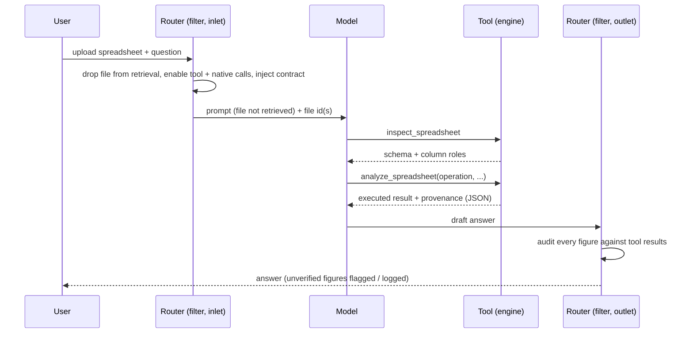

# Architecture

SheetProof is deliberately split into a **deterministic engine** (the tool) and a
**routing/guardrail layer** (the filter). The language model sits *between* them and is used only
for what it is good at — understanding the request and narrating verified results.

## Data flow

## The engine (`sheetproof.py`)

1. **File resolution.** Ids can arrive three ways: an explicit argument, files attached to the current
   message, or a stash placed by the router. All three come from the client request, so each id is
   format-checked (Open WebUI ids are UUIDs) and the file record must pass Open WebUI's read rule for
   the requesting user before its path is used. The path comes from Open WebUI's storage provider
   (local disk or S3/GCS/Azure); there is no filesystem fallback.
2. **Loading.** CSV/TSV and Excel are read with automatic **header-row detection** (skipping title
   or banner rows) and automatic **data-sheet selection** (the sheet with the most cells). For CSV the
   delimiter (comma, semicolon, tab or pipe) is detected from the first rows, and the same header
   detection runs on them before pandas' C parser reads the table. Column names are normalized;
   fully-empty rows/columns are dropped. Parsing runs in a worker thread, and the parsed table, its
   schema and its parsed measure columns are kept in a bounded LRU cache (`cache_max_entries`,
   `cache_max_mb`) so follow-up questions about the same file do not re-read it. The cache is consulted
   only after the access check, and its key includes the authorized file id, the file's path,
   modification time and size, and every parsing option.
3. **Schema inference.** Every column is assigned a universal role — `measure`, `dimension`,
   `temporal`, `identifier`, `text`, or `boolean` — from its values, not its name. Numeric coercion
   is locale-tolerant and strict: a cell counts as a number only if the whole cell is one (currency
   symbols/codes, thousands separators, parenthesis-negatives, percent and Arabic-Indic digits are
   accepted). The decimal separator is inferred per column from values that can only be read one way;
   ambiguous values (`1,234`) follow the column, then the rest of the file, then the
   `decimal_separator` valve, and every result reports the choice under `provenance.number_format`.
4. **Operations.** A closed set of relational operations (overview, aggregate, group, top-N, pivot,
   value counts, describe, time series, anomalies, duplicates, missing, compare) plus a composable
   `transform` pipeline. Each returns an executed result and provenance.
5. **Bounds.** `max_file_mb`, `max_uncompressed_mb` (with a zip-bomb ratio check) and `max_cells` are
   enforced before or while parsing; pivots are size-checked before they are built; `max_return_rows`
   caps returned rows, groups and periods and sets a `truncated` flag — never a silent drop.

### Code layout

Open WebUI installs a tool by pasting one file, so `sheetproof.py` is a single module divided into
sections, in this order: accepted inputs (the allow-lists), numbers stored as text, column roles,
reading spreadsheets, file access and the parsed-file cache, column-name matching, the expression
language and its evaluation, the transform pipeline, the operations of `analyze_spreadsheet` (one
method of `_Analysis` each), and finally the `Tools` class. `Tools` holds only the valves and the two
tool functions: Open WebUI 0.5 and 0.6 offer every other method of the class to the model as well.

## The safe expression grammar

The `filters` parameter and the `transform` pipeline need model-supplied expressions (e.g.
`` `Revenue` * (1 - `Discount`) `` or `` Region == 'North' and `Units` > 20 ``). Rather than `eval` or
`DataFrame.query`, expressions are parsed to an **AST** and validated against an allow-list before
anything is evaluated:

- A quote-aware tokenizer turns `` `quoted names` `` into `col('...')` and `@name` into a lookup in the
  call's `params` (never a Python variable).
- Allowed nodes: expression, boolean/binary/unary ops, comparisons, calls, keyword arguments, names,
  constants, lists, tuples, and the arithmetic/logic/comparison operators.
- Calls are permitted **only** to a fixed dictionary of whitelisted functions and to a fixed set of
  column methods (`.isna()`, `.between()`, `.str.contains()`, …). An attribute node is accepted only in
  that method position, and each method is implemented by SheetProof and dispatched through a table.
- Imports, dunder names, indexing, comprehensions, lambdas and any node outside the list are rejected;
  length, node-count and depth budgets bound parsing, and `**` needs a small literal exponent.
- Comparisons are typed: number literals compare numerically (text columns are parsed like measures),
  text literals compare as dates on date columns and as exact text otherwise.

Because no attribute or call outside those tables can be reached, the grammar cannot touch the Python
runtime — it can only compute over the dataframe.

## The router (`sheetproof_router.py`)

- **Inlet.** When a spreadsheet is attached it: removes the file from retrieval (so the file is not
  inserted into the prompt), stashes the file id where the tool can find it, enables the tool and native
  function calling for the turn, and injects a contract that forbids the model from computing numbers
  itself while leaving its answer style free.
- **Outlet.** Builds a "verified corpus" of numbers from **executed tool results only** (never from
  the model's reasoning or tool *arguments*), then checks every significant figure in the visible
  answer against it. Unverified figures are flagged (logged by default; optionally annotated). A
  second backstop checks categorical/text cells in answer tables against the file's recorded values.
- **Scope.** The router acts only on chats with a spreadsheet attached. All other chats are untouched.

## Design principles

- **The model never owns a number.** Arithmetic, counting, ranking, and date math are done by the
  engine; the model only decides *what* to compute and *how to explain it*.
- **Domain-neutral.** No dataset-specific logic. The same code analyzes sales, HR, finance, logs, or
  survey data without changes.
- **Auditable.** Provenance on every result, plus an independent output audit, make answers checkable.
