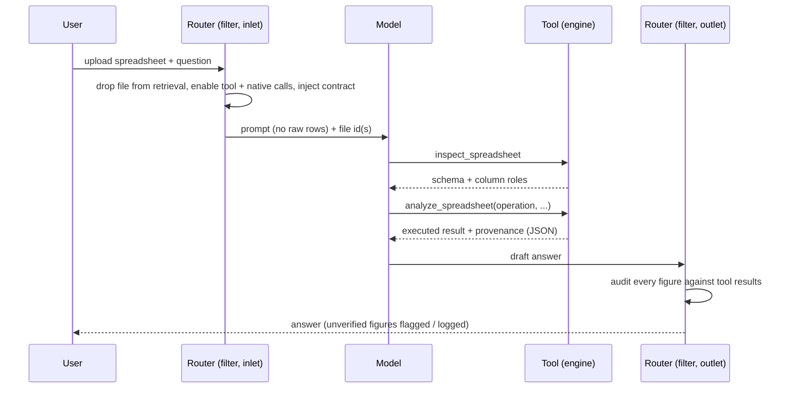

# Architecture

Spreadsheet Analyst is deliberately split into a **deterministic engine** (the tool) and a
**routing/guardrail layer** (the filter). The language model sits *between* them and is used only
for what it is good at — understanding the request and narrating verified results.

## Data flow

## The engine (`spreadsheet_analyst.py`)

1. **File resolution.** The tool locates the actual uploaded file through Open WebUI's file model,
   scoped to the requesting user, with a filesystem fallback by id. Ids can arrive three ways: an
   explicit argument, files attached to the current message, or a stash placed by the router.
2. **Loading.** CSV/TSV and Excel are read with automatic **header‑row detection** (skipping title
   or banner rows) and automatic **data‑sheet selection** (the sheet with the most cells). Column
   names are normalized; fully‑empty rows/columns are dropped.
3. **Schema inference.** Every column is assigned a universal role — `measure`, `dimension`,
   `temporal`, `identifier`, `text`, or `boolean` — from its values, not its name. Numeric coercion
   is locale‑tolerant (currency, thousands separators, parenthesis‑negatives, percent; US and
   European decimals).
4. **Operations.** A closed set of relational operations (overview, aggregate, group, top‑N, pivot,
   value counts, describe, time series, anomalies, duplicates, missing, compare) plus a composable
   `transform` pipeline. Each returns an executed result and provenance.
5. **Bounds.** `max_cells` rejects oversized files; `max_return_rows` caps detail rows and sets a
   `truncated` flag — rows are summarized, never silently dropped.

## The safe expression grammar

The `transform` pipeline needs user‑ and model‑supplied expressions (e.g. `` `Revenue` * (1 - `Discount`) ``).
Rather than `eval`, expressions are parsed to an **AST** and validated against an allow‑list:

- Allowed nodes: expression, boolean/binary/unary ops, comparisons, calls, names, constants, lists,
  tuples, and the arithmetic/logic/comparison operators.
- Calls are permitted **only** to a fixed dictionary of whitelisted functions.
- Attribute access, imports, dunder names, and any node outside the list are rejected before
  evaluation.

Because there is no attribute access and no call outside the whitelist, the grammar cannot reach the
Python runtime — it can only compute over the dataframe.

## The router (`spreadsheet_router.py`)

- **Inlet.** When a spreadsheet is attached it: removes the file from retrieval (so raw rows never
  enter the prompt), stashes the file id where the tool can find it, enables the tool and native
  function calling for the turn, and injects a contract that forbids the model from computing numbers
  itself while leaving its answer style free.
- **Outlet.** Builds a "verified corpus" of numbers from **executed tool results only** (never from
  the model's reasoning or tool *arguments*), then checks every significant figure in the visible
  answer against it. Unverified figures are flagged (logged by default; optionally annotated). A
  second backstop checks categorical/text cells in answer tables against the file's recorded values.
- **Scope.** The router acts only on chats with a spreadsheet attached. All other chats are untouched.

## Design principles

- **The model never owns a number.** Arithmetic, counting, ranking, and date math are done by the
  engine; the model only decides *what* to compute and *how to explain it*.
- **Domain‑neutral.** No dataset‑specific logic. The same code analyzes sales, HR, finance, logs, or
  survey data without changes.
- **Auditable.** Provenance on every result, plus an independent output audit, make answers checkable.
